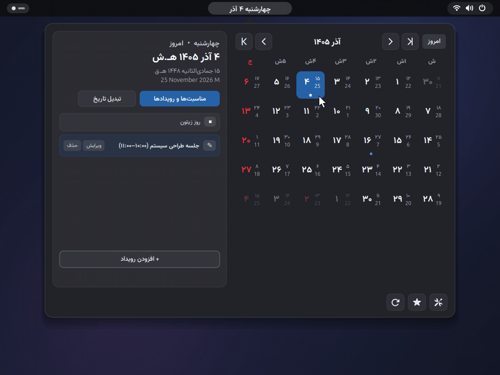

<div align="center">


<h1 dir="rtl">تقویم فارسی گنوم — Gnome-PersianCalendar</h1>

<p dir="rtl"><strong>افزونه تقویم هجری شمسی (جلالی) با همگام‌سازی Google Calendar برای GNOME Shell نسخه‌های ۴۶ تا ۵۰</strong></p>

<p>
  <a href="README.md">English</a> &middot; <strong dir="rtl">نسخه فارسی</strong>
</p>

<p>
  <a href="https://github.com/xSOH3ILx/Gnome-PersianCalendar/actions/workflows/ci.yml"></a>
  <a href="https://github.com/xSOH3ILx/Gnome-PersianCalendar/releases/latest"></a>
  
  
  <a href="LICENSE"></a>
</p>

</div>

---

<div align="center">
  
  <br />
  <sub dir="rtl">پیش‌نمای پاپ‌آپ تقویم شامل نشانگر نوار بالا، گرید ماهانه سه‌تقویمی، مناسبت‌ها و مبدل تاریخ</sub>
</div>

---

<div dir="rtl" align="right">

<h2>امکانات کلیدی</h2>

<h3>تقویم و نشانگر نوار بالا</h3>
<ul>
  <li><strong>نشانگر قابل تنظیم در نوار وضعیت:</strong> نمایش تاریخ شمسی در نوار بالای گنوم با قالب دلخواه، انتخاب موقعیت (چپ، وسط یا راست) و رنگ متن سفارشی.</li>
  <li><strong>گرید ماهانه سه‌تقویمی:</strong> نمایش هم‌زمان تاریخ <strong>خورشیدی (جلالی)</strong>، <strong>میلادی</strong> و <strong>هجری قمری</strong> با تفکیک تعطیلات، دکمه بازگشت سریع به «امروز» و ناوبری استاندارد راست‌به‌چپ.</li>
  <li><strong>مناسبت‌ها و تعطیلات رسمی:</strong> پوشش تعطیلات و مناسبت‌های شمسی، قمری، میلادی و جشن‌های کهن ایرانی همراه با نشانگر آبی زیر روزهای دارای رویداد شخصی یا گوگل.</li>
  <li><strong>افزودن مناسبت دلخواه با JSON بدون تغییر کد:</strong> تعریف یا اصلاح مناسبت‌ها از طریق فایل <code>~/.config/shamsi-calendar/extra-events.json</code> (راهنمای کامل در <a href="docs/EVENTS.md"><code>docs/EVENTS.md</code></a>).</li>
</ul>

<h3>رویدادهای شخصی و همگام‌سازی Google Calendar</h3>
<ul>
  <li><strong>اتصال مستقیم به Evolution Data Server (<code>EDS.js</code>):</strong> ثبت، ویرایش و حذف رویدادهای شخصی (تمام‌روز یا ساعت‌دار) مستقیم از داخل پاپ‌آپ تقویم.</li>
  <li><strong>همگام‌سازی خودکار با تقویم گنوم و گوگل:</strong> رویدادهای ذخیره‌شده در EDS به‌طور خودکار با <strong>GNOME Calendar</strong> و از طریق حساب آنلاین گنوم با <strong>Google Calendar</strong> همگام می‌شوند و نیاز به کلید API جداگانه ندارند.</li>
  <li><strong>یادآور رویداد (<code>VALARM</code>):</strong> امکان تنظیم یادآور (بدون یادآور، ۱۰ دقیقه، ۳۰ دقیقه، ۱ ساعت یا ۱ روز قبل) و انتخاب تقویم مقصد از بین تقویم‌های قابل نوشتن.</li>
</ul>

<h3>مبدل تاریخ، اعلان‌ها و معماری مدرن</h3>
<ul>
  <li><strong>مبدل یکپارچه تاریخ:</strong> تبدیل تاریخ‌های شمسی، میلادی و قمری با پشتیبانی از ارقام فارسی، عربی و لاتین (بازه اعتبارسنجی‌شده سال شمسی ۱۱۷۸ تا ۱۶۳۳).</li>
  <li><strong>اعلان‌های هوشمند:</strong> اعلان اختیاری هنگام شروع، نمایش مناسبت‌های روز و اعلام دقیق لحظه تحویل سال با تایمر بهینه نیمه‌شب به‌جای بررسی مداوم ۶۰ ثانیه‌ای.</li>
  <li><strong>معماری سازگار با GNOME 46–50:</strong> مبتنی بر ESM با پنجره تنظیمات بومی <strong>GTK4 / Libadwaita</strong>، ایزوله‌سازی متن‌های ترکیبی BiDi و زیرساخت ترجمه <code>gettext</code> (<code>po/shamsi-calendar.pot</code>).</li>
</ul>

</div>

---

<div dir="rtl" align="right">

<h2>نصب</h2>

<h3>روش ۱: اسکریپت نصب (از سورس)</h3>

</div>

```bash
git clone https://github.com/xSOH3ILx/Gnome-PersianCalendar.git
cd Gnome-PersianCalendar
./install.sh
```

<div dir="rtl" align="right">

<h3>روش ۲: بسته‌بندی استاندارد با Makefile</h3>

</div>

```bash
make install
```

<div dir="rtl" align="right">

<h3>روش ۳: نصب بسته آماده از صفحه Releases</h3>
<p>فایل <code>shamsi-calendar@gnome.scr.ir.shell-extension.zip</code> را از <a href="https://github.com/xSOH3ILx/Gnome-PersianCalendar/releases/latest">صفحه آخرین نسخه</a> دریافت و با دستور زیر نصب کنید:</p>

</div>

```bash
gnome-extensions install --force shamsi-calendar@gnome.scr.ir.shell-extension.zip
```

<div dir="rtl" align="right">

<h3>فعال‌سازی افزونه</h3>
<p>در نشست <strong>Wayland</strong> بعد از نصب یک‌بار از حساب کاربری خارج و دوباره وارد شوید، سپس افزونه را فعال کنید:</p>

</div>

```bash
gnome-extensions enable shamsi-calendar@gnome.scr.ir
```

<div dir="rtl" align="right">

<p>برای حذف افزونه:</p>

</div>

```bash
./uninstall.sh
# یا: make uninstall
```

---

<div dir="rtl" align="right">

<h2>راه‌اندازی حساب‌های آنلاین و Google Calendar</h2>

<ol>
  <li>در تنظیمات گنوم بخش <strong>Online Accounts (حساب‌های آنلاین)</strong> را باز کنید، حساب گوگل خود را اضافه کنید و دسترسی <strong>Calendar</strong> را روشن بگذارید.</li>
  <li>تنظیمات افزونه را باز کنید (<code>gnome-extensions prefs shamsi-calendar@gnome.scr.ir</code>) و گزینه همگام‌سازی تقویم را فعال کنید.</li>
  <li>رویدادهای تقویم‌های فعال در ماه انتخابی بارگذاری می‌شوند؛ فرم ثبت رویداد فقط تقویم‌های قابل نوشتن را نمایش می‌دهد و تقویم‌های فقط‌خواندنی همچنان قابل مشاهده هستند.</li>
</ol>

</div>

---

<div dir="rtl" align="right">

<h2>ساختار پروژه</h2>

</div>

```text
Gnome-PersianCalendar/
├── src/
│   ├── extension.js      # چرخه حیات افزونه، نشانگر نوار بالا و تایمر نیمه‌شب
│   ├── calendar.js       # گرید ماهانه، بخش مناسبت‌ها، مبدل و فرم رویداد EDS
│   ├── prefs.js          # پنجره تنظیمات GTK4 / Libadwaita
│   ├── EDS.js            # کلاینت D-Bus برای Evolution Data Server
│   ├── Events.js         # بارگذاری مناسبت‌ها و فایل JSON سفارشی
│   ├── Tarikh.js         # موتور محاسباتی تقویم شمسی، میلادی و قمری
│   ├── tahvil.js         # داده‌ها و محاسبات لحظه تحویل سال
│   ├── otherFunctions.js # توابع قالب‌بندی، اعداد و BiDi
│   ├── schemas/          # فایل‌های GSettings schema
│   └── events/           # داده‌های مناسبت‌ها و extra-events.json
├── tests/                # تست‌های واحد Node.js و تست قرارداد D-Bus با GJS
├── po/                   # فایل قالب ترجمه gettext (.pot)
├── docs/                 # نقشه راه، راهنمای مناسبت‌ها، گزارش‌های QA و تصاویر
├── Makefile              # کامندهای schemas / pack / install / test / lint / pot
└── .github/workflows/    # گردش‌کارهای CI و انتشار خودکار Release
```

---

<div dir="rtl" align="right">

<h2>توسعه و کنترل کیفیت</h2>

<p>برای اجرای ابزار بررسی کد (ESLint) ابتدا وابستگی‌های توسعه را نصب کنید:</p>

</div>

```bash
npm install
```

<div dir="rtl" align="right">

<p>فرمان‌های توسعه و تست:</p>

</div>

```bash
make test          # اجرای تست‌های خودکار واحد و بازگشتی (tests/*.test.mjs)
npm run test:gjs   # تست قرارداد EDS روی D-Bus خصوصی و سرویس ساختگی با gjs
make lint          # بررسی استاندارد کد با ESLint روی src/
make pot           # به‌روزرسانی فایل رشته‌های ترجمه po/shamsi-calendar.pot
make pack          # کامپایل schema و ساخت بسته قابل نصب در مسیر build/
```

<div dir="rtl" align="right">

<p><strong>نکات فنی:</strong></p>
<ul>
  <li>اجرای <code>npm run test:gjs</code> به ابزارهای <code>gjs</code> و <code>dbus-run-session</code> نیاز دارد و بدون دسترسی به حساب واقعی کاربر کار می‌کند.</li>
  <li>دامنه اعتبارسنجی‌شده مبدل تاریخ سال‌های شمسی ۱۱۷۸ تا ۱۶۳۳ است و دقت مناسبت‌های قمری آینده به جدول داده‌ها و تقویم رسمی منتشرشده وابسته است.</li>
</ul>

<h2>نقشه راه و تاریخچه تغییرات</h2>
<ul>
  <li>برنامه نسخه‌های بعدی (ناوبری کیبورد، جستجوی مناسبت‌ها، پیش‌نمای زنده قالب تاریخ و انتشار در EGO): <a href="docs/ROADMAP.md"><code>docs/ROADMAP.md</code></a></li>
  <li>تاریخچه تغییرات نسخه‌ها: <a href="CHANGELOG.md"><code>CHANGELOG.md</code></a></li>
  <li>راهنمای افزودن مناسبت‌های JSON: <a href="docs/EVENTS.md"><code>docs/EVENTS.md</code></a></li>
</ul>

<h2>مجوز و قدردانی</h2>
<p>این پروژه تحت مجوز <a href="LICENSE"><strong>GPL-3.0</strong></a> منتشر می‌شود و بر پایه پروژه <a href="https://github.com/SCR-IR/gnome-shamsi-calendar">SCR-IR/gnome-shamsi-calendar</a> برای GNOME Shell نسخه‌های ۴۶ تا ۵۰ بازسازی و توسعه یافته است.</p>

</div>
