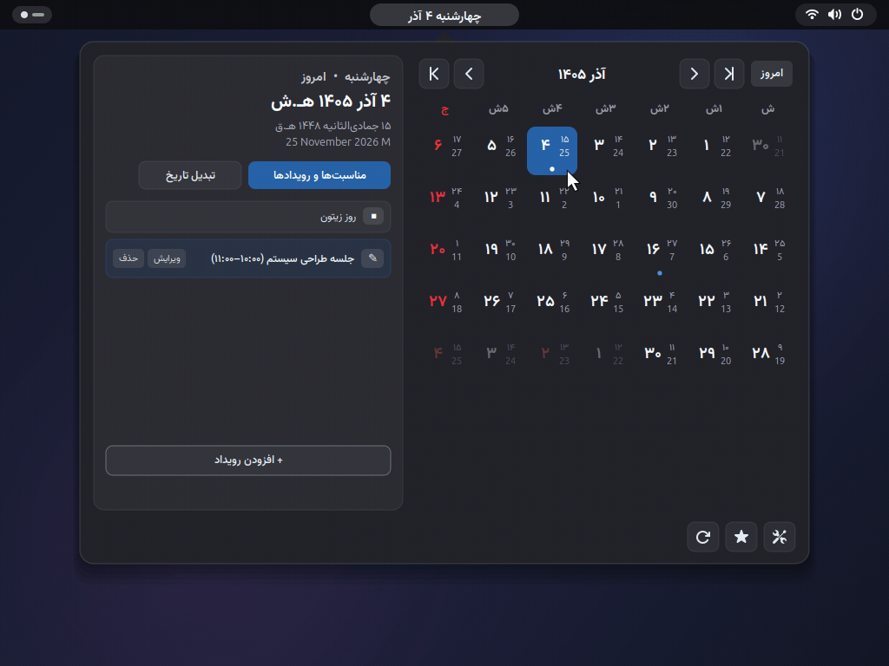

<div align="center">


# Gnome-PersianCalendar

**Modern Persian (Jalali) Solar Calendar &amp; Google Calendar Sync Extension for GNOME Shell 46–50**

<p>
  <strong>English</strong> &middot; <a href="README.fa.md" dir="rtl">نسخه فارسی</a>
</p>

<p>
  <a href="https://github.com/xSOH3ILx/Gnome-PersianCalendar/actions/workflows/ci.yml"></a>
  <a href="https://github.com/xSOH3ILx/Gnome-PersianCalendar/releases/latest"></a>
  
  
  <a href="LICENSE"></a>
</p>

</div>

---

<div align="center">
  
  <br />
  <sub>Calendar popup preview showing top-panel indicator, monthly tri-calendar grid, events, and converter</sub>
</div>

---

## Key Features

### Calendar &amp; Top Panel Indicator
- **Customizable Panel Indicator:** Displays the Jalali date in the GNOME top bar with configurable format tokens, panel placement (`right`, `center`, `left`), and custom text color.
- **Tri-Calendar Monthly Grid:** Shows **Persian (Jalali)**, **Gregorian**, and **Islamic Hijri** dates simultaneously with weekend/holiday highlighting, a quick **Today** jump button, and RTL-aware month/year navigation.
- **Events &amp; Official Holidays:** Includes Iranian official holidays, Islamic and Gregorian observances, and ancient Persian festivals, plus blue dot indicators under days with personal or synced events.
- **Custom JSON Events (No Code Changes):** Add or override custom holidays and personal dates via `~/.config/shamsi-calendar/extra-events.json` (see [`docs/EVENTS.md`](docs/EVENTS.md)).

### Personal Events &amp; Google Calendar Sync (EDS)
- **Native Evolution Data Server (`EDS.js`) Integration:** Create, edit, and delete personal events (all-day or timed) directly from the calendar popup.
- **Automatic GNOME &amp; Google Sync:** Events saved to EDS automatically sync with **GNOME Calendar** and **Google Calendar** through GNOME Online Accounts—no separate API keys or tokens required.
- **Event Reminders (`VALARM`):** Attach reminders (`None`, `10 min`, `30 min`, `1 hour`, or `1 day` before) and choose target writable calendars while still displaying read-only calendars.

### Converter, Notifications &amp; Architecture
- **Built-in Date Converter:** Converts between Jalali, Gregorian, and Hijri calendars (validated across Jalali years `1178–1633`), accepting Latin, Persian, and Arabic digits.
- **Smart Notifications:** Optional startup notification, daily event summaries, and exact **Vernal Equinox (Tahvil-e Sal)** alerts powered by an efficient midnight timer instead of 60-second polling.
- **Modern GNOME 46–50 Codebase:** ESM-based GNOME Shell extension with **GTK4 / Libadwaita** preferences (`src/prefs.js`), full RTL support with Unicode BiDi isolation (`LRI/PDI`), and `gettext` i18n infrastructure (`po/shamsi-calendar.pot`).

---

## Installation

### Option 1: Install Script (from source)
```bash
git clone https://github.com/xSOH3ILx/Gnome-PersianCalendar.git
cd Gnome-PersianCalendar
./install.sh
```

### Option 2: Standard Makefile Packaging
```bash
make install
```

### Option 3: Prebuilt Release Package
Download `shamsi-calendar@gnome.scr.ir.shell-extension.zip` from the [Latest Release](https://github.com/xSOH3ILx/Gnome-PersianCalendar/releases/latest) and install it:
```bash
gnome-extensions install --force shamsi-calendar@gnome.scr.ir.shell-extension.zip
```

### Enable the Extension
On **Wayland**, log out and log back in after installing, then enable:
```bash
gnome-extensions enable shamsi-calendar@gnome.scr.ir
```

To uninstall at any time:
```bash
./uninstall.sh
# or: make uninstall
```

---

## Google Calendar &amp; Online Accounts Setup

1. Open **GNOME Settings &rarr; Online Accounts**, sign in with your Google account, and make sure **Calendar** access is enabled.
2. Open the extension preferences (`gnome-extensions prefs shamsi-calendar@gnome.scr.ir`) and enable calendar sync.
3. Events from enabled system calendars load for the displayed month. The event creation form lists writable calendars only, while read-only calendars continue to appear in the popup.

---

## Project Structure

```text
Gnome-PersianCalendar/
├── src/
│   ├── extension.js      # GNOME Shell lifecycle, panel indicator, midnight timer
│   ├── calendar.js       # Popup grid, events view, converter tab, EDS event form
│   ├── prefs.js          # GTK4 / Libadwaita preferences window
│   ├── EDS.js            # Evolution Data Server D-Bus client (VEVENT / VALARM)
│   ├── Events.js         # Holiday, observance, and JSON event loader
│   ├── Tarikh.js         # Jalali / Gregorian / Hijri calendar math engine
│   ├── tahvil.js         # Vernal equinox (Tahvil) tables and calculations
│   ├── otherFunctions.js # Formatting and BiDi / digit helpers
│   ├── schemas/          # GSettings XML schema
│   └── events/           # Built-in calendar events and extra-events.json
├── tests/                # Node unit tests & GJS/D-Bus EDS contract tests
├── po/                   # gettext translation template (.pot)
├── docs/                 # Roadmap, custom events guide, QA notes, assets
├── Makefile              # schemas / pack / install / test / lint / pot
└── .github/workflows/    # CI & automated tag-based Release workflows
```

---

## Development &amp; Testing

Install dev dependencies (used for ESLint):
```bash
npm install
```

Available development commands:
```bash
make test          # Run Node.js unit & regression tests (tests/*.test.mjs)
npm run test:gjs   # Run EDS D-Bus contract tests under private dbus-run-session
make lint          # Run ESLint across src/
make pot           # Regenerate po/shamsi-calendar.pot translation strings
make pack          # Compile schemas and build installable zip under build/
```

**Notes on scope &amp; accuracy:**
- `npm run test:gjs` requires `gjs` and `dbus-run-session` and runs against a mock D-Bus service without touching real user accounts.
- The date converter is validated for Jalali years `1178` through `1633`; future lunar (Hijri) observance accuracy depends on published official calendar tables.

---

## Roadmap &amp; Changelog

- Upcoming features (keyboard grid navigation, event search, live date format preview, and EGO publishing): [`docs/ROADMAP.md`](docs/ROADMAP.md)
- Detailed release history: [`CHANGELOG.md`](CHANGELOG.md)
- Custom JSON events guide: [`docs/EVENTS.md`](docs/EVENTS.md)

---

## License &amp; Acknowledgments

Distributed under the [**GNU General Public License v3.0**](LICENSE).  
Rebuilt, modernized for GNOME Shell 46–50, and extended with EDS/Google Calendar integration based on [`SCR-IR/gnome-shamsi-calendar`](https://github.com/SCR-IR/gnome-shamsi-calendar).
